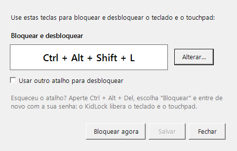

# KidLock

Bloqueia e desbloqueia o **teclado e o touchpad/mouse** do notebook com uma combinação de teclas.
Assim a criança pode assistir a um vídeo sem fechar janelas, apagar arquivos ou mandar mensagens por
acidente.

> *English:* KidLock is a small Windows tray app that locks/unlocks keyboard and touchpad with a
> hotkey (`Ctrl+Alt+Shift+L`), so kids can watch videos without messing with the computer. Download
> the installer from [Releases](../../releases/latest). The UI is in Brazilian Portuguese.

---

## Para quem vai usar

### 1. Baixar

Baixe o arquivo **`KidLock-Setup-<versão>.exe`** (cerca de 42 MB) na página
**[Releases](../../releases/latest)**.

Funciona em **qualquer Windows 10 ou 11** (32 bits, 64 bits ou ARM). **Não precisa instalar mais
nada:** o instalador já traz tudo o que o programa precisa, funciona sem internet e não pede senha
de administrador.

### 2. Instalar

1. Dê dois cliques no arquivo baixado.
2. Se aparecer **"O Windows protegeu o computador"**, clique em **Mais informações** e depois em
   **Executar assim mesmo**. Esse aviso aparece porque o KidLock é gratuito e não tem certificado
   digital pago; o código está todo aqui, aberto para quem quiser conferir.
3. Deixe marcado **"Iniciar o KidLock junto com o Windows"** e clique em **Instalar**.
4. No fim, o instalador mostra um resumo de como usar. Clique em **Concluir** e o KidLock abre,
   já mostrando a janela com o atalho de bloquear e desbloquear.

### 3. Usar

Procure o cadeado perto do relógio, na barra de tarefas:

| | |
|---|---|
|  | **Verde:** teclado e touchpad livres |
|  | **Vermelho:** bloqueados |

> Não está vendo? Clique na setinha **^** ao lado do relógio. Para deixá-lo sempre visível, arraste o
> cadeado para a barra de tarefas.

**Para bloquear e desbloquear, aperte juntas: `Ctrl` + `Alt` + `Shift` + `L`**

- O mesmo atalho bloqueia e desbloqueia.
- Ao bloquear, aparece este aviso no topo da tela por alguns segundos. Ele volta quando alguém tenta
  mexer, mas não fica cobrindo o vídeo:

  

- Apertar várias teclas ao mesmo tempo **não** desbloqueia: o atalho só vale exatamente com essas
  quatro teclas. A criança pode bater no teclado à vontade.

**Ver ou trocar o atalho:** dê **dois cliques no cadeado**. Abre esta janela, que mostra as teclas
de bloquear e desbloquear (passar o mouse sobre o cadeado também mostra):



Para trocar, clique em **Alterar…**, aperte a nova combinação e clique em **Salvar**. Se quiser um
atalho só para bloquear e outro para desbloquear, marque **"Usar outro atalho para desbloquear"**.
Por segurança, o atalho precisa ter pelo menos dois entre Ctrl, Alt, Shift e Win, mais uma tecla.

**Esqueceu o atalho? (emergência)** Aperte **`Ctrl` + `Alt` + `Del`**, escolha **Bloquear** e entre de
novo com a sua senha. O KidLock libera teclado e touchpad automaticamente. O Windows nunca deixa um
programa bloquear o Ctrl+Alt+Del, então essa saída sempre funciona.

**Mais opções:** clique com o botão direito no cadeado para:

- **Atalhos de teclado...**: a mesma janela do duplo clique
- **Bloquear agora**
- **Bloquear teclado** / **Bloquear mouse e touchpad**: escolher o que bloquear
- **Iniciar com o Windows**: ligar ou desligar
- **Editar configurações...**: outras opções avançadas (veja abaixo)
- **Sair**

### 4. Desinstalar

*Configurações do Windows → Aplicativos → Aplicativos instalados → KidLock → Desinstalar.*
No fim ele pergunta se você quer apagar também as configurações.

### Configurações (opcional)

Em **Editar configurações...** o arquivo `settings.json` abre no Bloco de Notas. Ao salvar, a mudança
vale na hora. Se algum valor estiver errado, o KidLock usa o padrão e avisa no cadeado.

| Campo | Padrão | O que faz |
|---|---|---|
| `lockHotkey` | `Ctrl+Alt+Shift+L` | Atalho para bloquear |
| `unlockHotkey` | `Ctrl+Alt+Shift+L` | Atalho para desbloquear (igual ao de bloquear = o mesmo atalho alterna) |
| `blockKeyboard` | `true` | Bloqueia o teclado |
| `blockMouse` | `true` | Bloqueia touchpad e mouse |
| `allowInjectedInput` | `false` | Deixa passar comandos de programas de acesso remoto e automação |
| `showOverlay` | `true` | Mostra o aviso "bloqueado" no topo da tela |
| `showHotkeyHintInOverlay` | `false` | Escreve o atalho de desbloqueio no aviso |
| `playSounds` | `true` | Toca um som ao bloquear e ao desbloquear |
| `unlockOnSessionLock` | `true` | Libera tudo quando a sessão do Windows é bloqueada (a saída de emergência) |

O jeito mais fácil de trocar os atalhos é pela janela do duplo clique. No arquivo, eles usam
`Ctrl`, `Alt`, `Shift`, `Win` + uma tecla (`A`–`Z`, `0`–`9`, `F1`–`F24`, `Space`,
`Enter`, `Esc`, `Tab`, `Delete`, `Home`, `End`, `PageUp`, `PageDown`, setas, `NumPad0`–`NumPad9`...).
Por segurança é preciso usar **pelo menos 2 modificadores**, e combinações do Windows (Ctrl+Alt+Del,
Win+L, Ctrl+Shift+Esc) não são aceitas.

### Limitações conhecidas

- **Gestos de 3 ou 4 dedos no touchpad** (trocar de janela, mostrar a área de trabalho) são tratados
  pelo próprio Windows e podem funcionar mesmo com o bloqueio. Se incomodar, desligue-os em
  *Configurações → Bluetooth e dispositivos → Touchpad → Gestos*.
- **Telas sensíveis ao toque** não são bloqueadas.
- Janelas abertas **como administrador** (por exemplo, o Gerenciador de Tarefas) continuam
  respondendo enquanto estão na frente.
- Alguns antivírus desconfiam de programas que observam o teclado. O KidLock não grava, não envia e
  não guarda nada do que é digitado: ele só decide se cada tecla passa ou não. O código está todo
  aqui para conferir.

---

## Para desenvolvedores

Pré-requisitos: Windows 10/11, .NET SDK 8 e, para gerar o instalador,
[Inno Setup 6](https://jrsoftware.org/isinfo.php) (`winget install JRSoftware.InnoSetup`).

```powershell
.\build.ps1                              # build + testes unitários + instalador
.\build.ps1 -Target Test                 # só build e testes unitários
.\build.ps1 -Target IntegrationTest      # testes com ganchos reais do Windows
.\build.ps1 -Target Installer -Version 1.2.0
.\build.ps1 -Target Publish -PublishProfile win-x64   # versão portátil (um único .exe)
```

O instalador sai em `artifacts\installer\`. Ele leva o programa compilado para x86 com o runtime .NET
embutido, então roda em Windows de 32 bits, 64 bits e ARM.

Os testes de integração instalam ganchos globais e injetam teclas inofensivas (F23, F24, Shift).
Durante frações de segundo o teclado e o mouse físicos também ficam bloqueados.

**CI/CD** ([`.github/workflows/ci.yml`](.github/workflows/ci.yml)): a cada push ou pull request
compila, roda os testes unitários e gera o instalador e as versões portáteis como artefatos. Uma tag
`vX.Y.Z` publica um Release com tudo isso. Os testes de integração rodam sob demanda
(*Actions → CI → Run workflow → integration*), porque exigem um desktop interativo.

Arquitetura e decisões de projeto: [docs/ARCHITECTURE.md](docs/ARCHITECTURE.md).

## Licença

[MIT](LICENSE): pode usar, copiar, modificar e distribuir à vontade, mantendo o aviso de copyright.
