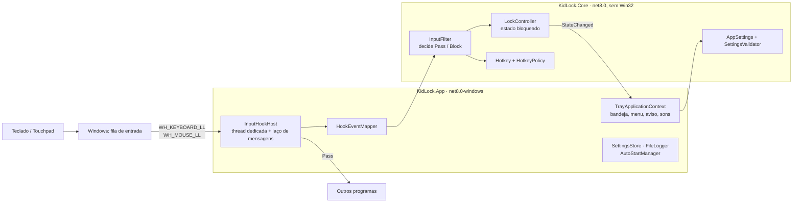

# Arquitetura do KidLock

## Visão geral

| Projeto | Responsabilidade | Dependências |
|---|---|---|
| `KidLock.Core` | Toda a lógica de decisão: atalhos, estado, filtro, configurações | nenhuma (BCL) |
| `KidLock.App` | Ganchos Win32, ícone na bandeja, aviso na tela, log, início automático | Core, WinForms |
| `KidLock.Core.Tests` | Unitários + testes de propriedade (milhares de eventos aleatórios) | Core |
| `KidLock.App.Tests` | Unitários da camada nativa + integração com ganchos reais | App, Core |

A regra é: **nada que precise de decisão fica no App**. O App só traduz mensagens do Windows para
eventos do núcleo e devolve a decisão. Assim, o comportamento crítico é testado sem Windows,
sem tempo real e de forma determinística (relógio falso via `TimeProvider`).

## Decisões de projeto

### 1. Ganchos de baixo nível em vez de desativar o dispositivo

Desativar o touchpad/teclado via Gerenciador de Dispositivos exige administrador e, se o programa
travar, o dispositivo continua desligado (até depois de reiniciar). Os ganchos `WH_KEYBOARD_LL` e
`WH_MOUSE_LL` rodam sem administrador e somem junto com o processo: **se o KidLock morrer, a entrada
volta sozinha**. O custo são as limitações do README (gestos do touchpad, janelas elevadas).

### 2. Thread dedicada para os ganchos

O Windows chama o gancho na thread que o instalou e o remove em silêncio se a resposta passar de
`LowLevelHooksTimeout` (~1 s). Por isso `InputHookHost` cria uma thread própria, de prioridade alta,
que só faz laço de mensagens. A UI nunca consegue atrasar uma decisão. Os callbacks fazem só o
mínimo (decisão em memória + um `Post` limitado a 1x/s para a UI).

### 3. Falha aberta

Exceção ao processar um evento → o evento passa. Um bug nunca pode deixar o computador sem teclado.
Somado à saída de emergência (Ctrl+Alt+Del → Bloquear), sempre há como recuperar o controle.

### 4. Atalho com correspondência exata

O atalho só vale se os modificadores forem exatamente os configurados e nenhuma outra tecla comum
estiver pressionada. Uma criança "amassando" o teclado aperta várias teclas juntas, o que invalida
o atalho. `HotkeyPolicy` exige ≥ 2 modificadores e recusa combinações do Windows.

### 5. Invariante "soltura acompanha a descida"

Engolir eventos de forma ingênua deixa teclas presas: se Ctrl desce antes do bloqueio e a soltura é
engolida, o Windows acha que Ctrl continua pressionado. O `InputFilter` mantém o invariante:

> para cada tecla rastreada, *não estar em `_swallowedKeys`* ⇔ *o Windows viu a tecla descer e ainda
> não viu subir*.

Consequências: Ctrl/Alt/Shift do atalho de bloqueio descem e sobem normalmente; tudo que desce
durante o bloqueio sobe engolido, mesmo que o desbloqueio aconteça no meio; auto-repetição segue o
destino do pressionamento original. O mesmo vale para botões do mouse. Os testes de propriedade
verificam isso com 20 mil eventos aleatórios por semente.

### 6. Teclas "fantasma" expiram

Ctrl+Alt+Del troca para a área de trabalho segura e o gancho nunca vê as solturas. Sem cuidado, o
filtro acharia que Ctrl, Alt e Del continuam pressionados e o atalho exato nunca mais casaria.
`KeyboardState` guarda o instante do último evento de cada tecla; depois de 5 s sem eventos a tecla
deixa de contar para o atalho. Além disso, bloqueio/desbloqueio de sessão e retorno da suspensão
zeram o estado (`ResetInputState`) e reinstalam os ganchos (`Rearm`, sem janela desprotegida:
instala os novos antes de remover os antigos).

### 7. Máscara de menu

Se o atalho de bloqueio usa Alt (ou Win) e engolimos só a tecla final, o Windows vê "Alt desceu e
subiu sozinho" e ativa a barra de menus do programa em primeiro plano (ou abre o Iniciar, no caso
do Win). O filtro sinaliza `RequestMenuMask` e o host injeta a tecla sem atribuição `0xE8` logo
depois, marcada com `SelfInjectionMarker` para o próprio filtro ignorá-la.

### 8. Ninguém bloqueia sem saber como sair

O duplo clique no cadeado **mostra** os atalhos (janela `HotkeySettingsForm`) em vez de bloquear, e
essa janela abre sozinha na primeira execução. A dica do ícone também mostra o atalho. Bloquear
exige o atalho, o item do menu ou o botão "Bloquear agora" da própria janela, sempre com o atalho
visível.

Para trocar o atalho, a nova combinação é capturada pelo **gancho** (`InputFilter.BeginHotkeyCapture`),
não pela janela: funciona até com combinações que o Windows trata antes de qualquer janela (Win+…),
o atalho atual fica suspenso durante a escolha e as teclas não vazam para outros programas. A
captura respeita o mesmo invariante de soltura e expira sozinha em 30 s, para o teclado nunca ficar
preso se a janela sumir. As regras de validação (`HotkeySettingsModel`) ficam no núcleo e são testadas
sem interface.

### 9. Distribuição: instalador sem pré-requisitos

O instalador (`installer/KidLock.iss`, Inno Setup 6) empacota o programa **self-contained**: o
runtime .NET vai junto, então a máquina de destino não precisa de nada instalado antes, nem de
internet. Escolhas:

- **x86**: roda em Windows 10/11 de 32 bits, 64 bits e ARM (o Windows 10 ARM só emula x86).
  Os ganchos de baixo nível funcionam entre arquiteturas, porque o Windows os chama na thread que os
  instalou, sem injetar código em outros processos.
- **Pasta, não arquivo único**: o instalador já comprime (LZMA2, cerca de 134 MB viram 42 MB), e o
  programa abre mais rápido e usa menos memória do que um `.exe` único com compressão.
- **Por usuário, sem administrador** (`%LOCALAPPDATA%\Programs\KidLock`), com desinstalação em
  "Aplicativos instalados".
- Antes de copiar arquivos (e ao desinstalar), o instalador encerra o KidLock. Encerrar o processo
  remove os ganchos, então teclado e touchpad voltam na hora.
- O início automático usa o mesmo valor do registro (`HKCU\...\Run\KidLock`) que o menu do programa,
  então os dois ficam sincronizados.

## Modelo de threads

| Thread | O que roda |
|---|---|
| UI (STA) | `TrayApplicationContext`, menu, aviso, `FileSystemWatcher` (via Post), `SystemEvents` |
| `KidLock input hooks` | callbacks dos ganchos → `InputFilter` (lock interno curto) |
| `KidLock logger` | grava o log em disco a partir de uma fila |

`LockController.StateChanged` é disparado fora de qualquer lock; o assinante da UI só faz `Post` e,
ao atualizar a tela, lê `IsLocked` (em vez de confiar na ordem dos eventos).

## Estratégia de testes

| Camada | Como | Onde roda |
|---|---|---|
| Atalhos, política, estado | unitários (xUnit) | CI e local |
| `InputFilter` | unitários de cada cenário + testes de propriedade (criança amassando teclas, alternâncias aleatórias, nenhuma tecla/botão presos) | CI e local |
| Configurações | arquivo ausente, corrompido, parcial, com comentários, atalhos inválidos | CI e local |
| Camada nativa | layout das structs Win32, mapeamento de mensagens, registro (chave temporária), log, renderização de ícones/aviso | CI e local |
| Integração | ganchos reais + `SendInput`; um gancho "testemunha" instalado antes do KidLock prova o que chegou aos outros programas | local / sob demanda (`Category=Integration`) |

O gancho testemunha funciona porque o Windows chama os ganchos do mais novo para o mais antigo: se o
KidLock engole um evento, a cadeia para e a testemunha nunca o vê. Os testes usam teclas que não
existem na maioria dos teclados (F23/F24) e marcam os eventos injetados, ignorando a digitação real.
